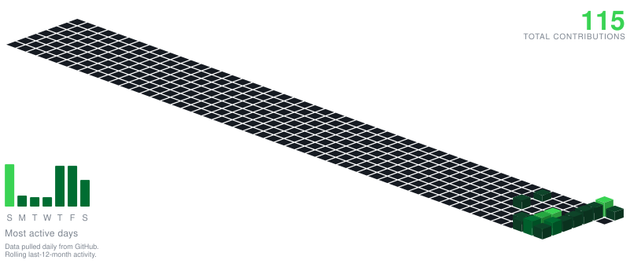

<h1 align="center">¡illo que diC, bro!👋 Bienvenido a mi perfil secundario</h1>

---

# 🚀 Sobre mí

Soy un apasionado del desarrollo de software, la ingeniería inversa y la seguridad en dispositivos móviles. En este espacio centralizo forks, herramientas de auditoría y proyectos experimentales enfocados en el ecosistema Android y utilidades de alto rendimiento.

---

# 🛠️ Tecnologías y Herramientas

   &nbsp;&nbsp;
   &nbsp;&nbsp;
   &nbsp;&nbsp;
   &nbsp;&nbsp;
   &nbsp;&nbsp;
   &nbsp;&nbsp;
  

---

# 📌 Repositorios Destacados

*   **[DemoniTalk-Pro](https://github.com/Jaypsmall/DemoniTalk-Pro)**: Versión avanzada optimizada y reconstruida con Flutter y motor nativo en Rust para comandos de voz y accesibilidad.
   
*   **[HexRootScan](https://github.com/Jaypsmall/HexRootScan)**: Herramienta potente de auditoría de redes y pruebas de penetración diseñada exclusivamente para dispositivos Android.

*   **[HexRootFuzz](https://github.com/Jaypsmall/HexRootFuzz)**: Módulo de fuzzing y pruebas de estrés para análisis de seguridad y vulnerabilidades en entornos Android.

*   **[HexColor-Pro](https://github.com/Jaypsmall/HexColor-Pro)**: Aplicación multiplataforma profesional con paleta de colores para desarrolladores y diseñadores (captura de cámara, armonías e HSL).

*   **[HexColor](https://github.com/Jaypsmall/HexColor)**: Herramienta de paleta de colores optimizada para entornos Android con renderizado nativo.

*   **[DemoniWifi](https://github.com/Jaypsmall/DemoniWifi)**: Herramienta de análisis, diagnóstico y auditoría de redes inalámbricas para Android.

*   **[CpuTemp](https://github.com/Jaypsmall/CpuTemp)**: Utilidad de monitoreo del sistema en tiempo real para control de temperatura y frecuencias térmicas del procesador.

*   **[Daltonic-Assist-Pro](https://github.com/Jaypsmall/Daltonic-Assist-Pro)**: Aplicación de accesibilidad visual diseñada para asistencia en tiempo real a usuarios con deficiencias en la percepción del color.
   

<!-- APP_SHOWCASE_START -->

<table width="100%" align="center" cellspacing="5" cellpadding="0">
<tr>
<td width="50%" valign="top" align="center">
<h2>😈 Dark Tools 😈</h2>
<b>Root &nbsp;·&nbsp; Pentesting &nbsp;·&nbsp; Android</b>
  
<table align="center" cellspacing="4" cellpadding="0">
<tr>
<td align="center" style="border: 2px solid #FFD600; background-color: #030B12; padding: 6px; border-radius: 8px;">

</td>
<td align="center" style="border: 2px solid #FFD600; background-color: #030B12; padding: 6px; border-radius: 8px;">

</td>
<td align="center" style="border: 2px solid #FFD600; background-color: #030B12; padding: 6px; border-radius: 8px;">

</td>
<td align="center" style="border: 2px solid #FFD600; background-color: #030B12; padding: 6px; border-radius: 8px;">

</td>
</tr>
<tr>
<td align="center" style="border: 2px solid #FFD600; background-color: #030B12; padding: 6px; border-radius: 8px;">

</td>
<td align="center" style="border: 2px solid #FFD600; background-color: #030B12; padding: 6px; border-radius: 8px;">

</td>
<td align="center" style="border: 2px solid #FFD600; background-color: #030B12; padding: 6px; border-radius: 8px;">

</td>
<td align="center" style="border: 2px solid #FFD600; background-color: #030B12; padding: 6px; border-radius: 8px;">

</td>
</tr>
</table>
</td>
<td width="50%" valign="top" align="center">
<h2>📱 General Apps 📱</h2>
<b>Utilities &nbsp;·&nbsp; Accessibility &nbsp;·&nbsp; Science</b>
  
<table align="center" cellspacing="4" cellpadding="0">
<tr>
<td align="center" style="border: 2px solid #FFD600; background-color: #030B12; padding: 6px; border-radius: 8px;">

</td>
<td align="center" style="border: 2px solid #FFD600; background-color: #030B12; padding: 6px; border-radius: 8px;">

</td>
<td align="center" style="border: 2px solid #FFD600; background-color: #030B12; padding: 6px; border-radius: 8px;">

</td>
<td align="center" style="border: 2px solid #FFD600; background-color: #030B12; padding: 6px; border-radius: 8px;">

</td>
</tr>
<tr>
<td align="center" style="border: 2px solid #FFD600; background-color: #030B12; padding: 6px; border-radius: 8px;">

</td>
<td align="center" style="border: 2px solid #FFD600; background-color: #030B12; padding: 6px; border-radius: 8px;">

</td>
<td align="center" style="border: 2px solid #FFD600; background-color: #030B12; padding: 6px; border-radius: 8px;">

</td>
<td align="center" style="border: 2px solid #FFD600; background-color: #030B12; padding: 6px; border-radius: 8px;">

</td>
</tr>
</table>
</td>
</tr>
</table>

<!-- APP_SHOWCASE_END -->

---

# 📊 Estadísticas de GitHub

<table width="100%" align="center">

<tr width="100%" align="center">

<td width="100%" align="center" style="background:#030B12; border:2px solid #6840B8; padding:2px;">

## 📡 CONNECT & SYSTEM INFO

</td>

</tr>

</table>

